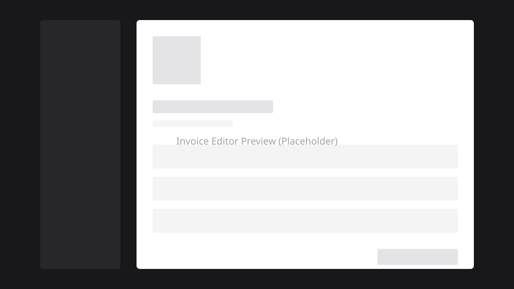

<div align="center">

<h1>✨ Magic Invoice ✨</h1>

**Create beautiful, professional invoices in real-time. No sign-up required.**

[](https://nextjs.org/)
[](https://react.dev/)
[](https://www.typescriptlang.org/)
[](https://tailwindcss.com/)

[Demo](#demo) • [Report Bug](https://github.com/ThanosKa/magic-invoice/issues) • [Request Feature](https://github.com/ThanosKa/magic-invoice/issues)

[](https://x.com/KazakisThanos)
[](https://buymeacoffee.com/thaka)

</div>

---

## 📸 Screenshot

<div align="center">
  
</div>

## Table of Contents

- [Screenshot](#screenshot)
- [About](#about)
- [Features](#features)
- [Demo](#demo)
- [Built With](#built-with)
- [Getting Started](#getting-started)
  - [Prerequisites](#prerequisites)
  - [Installation](#installation)
  - [Environment Setup](#environment-setup)
- [Usage](#usage)
- [Deployment](#deployment)
- [Contributing](#contributing)
- [License](#license)
- [Acknowledgments](#acknowledgments)
- [Star History](#star-history)
- [Contributors](#contributors)
- [Support](#support)
- [Contact](#contact)

## About

Magic Invoice is a modern, real-time invoice editor built with Next.js, Shadcn UI, and Tailwind CSS. It allows you to create beautiful, professional invoices instantly and export them as PDFs—all directly in your browser without any sign-up required.

### Use Cases

- **Freelancers**: Quickly generate professional invoices for clients
- **Small Businesses**: Create branded invoices without complex software
- **Service Providers**: Streamline billing and payment tracking
- **Anyone**: Need a quick, professional invoice? Magic Invoice has you covered

## Features

- ✨ **Real-Time Editing**: See your changes instantly as you type
- 🔒 **Privacy First**: All data is processed locally in your browser; no financial information is stored on servers
- 🎨 **Modern Design**: Built with a premium monochrome aesthetic using Shadcn UI and Framer Motion
- 📄 **PDF Export**: Generate pixel-perfect PDFs of your invoices
- 🌍 **Multilingual Support**: Supports multiple languages via i18n (English, German, Spanish, French, Italian, Greek)
- 🎯 **Wizard-Based Form**: Step-by-step invoice creation with validation
- 💳 **Payment Tracking**: Track payment status and methods
- ✍️ **Digital Signatures**: Add signatures to your invoices
- 📊 **Multiple Export Formats**: Export as PDF, JSON, CSV, or XML
- 📧 **Email Integration**: Send invoices directly via email
- 🌙 **Dark Mode**: Beautiful dark theme support
- **100% Open Source** — Apache 2.0 licensed

## Demo

Visit the live demo: [magic-invoice.kazakis-th.workers.dev](https://magic-invoice.kazakis-th.workers.dev)

### Quick Preview

1. **Create Invoice**: Fill in your business and client details
2. **Add Items**: Add line items with descriptions, quantities, and prices
3. **Customize**: Add payment terms, notes, and signatures
4. **Export**: Download as PDF or export in other formats
5. **Share**: Send invoices via email directly from the app

## Built With

| Technology                                      | Purpose                         | Version  |
| ----------------------------------------------- | ------------------------------- | -------- |
| [Next.js](https://nextjs.org/)                  | React framework with App Router | 16.0.8   |
| [React](https://react.dev/)                     | UI library                      | 19.3.1   |
| [TypeScript](https://www.typescriptlang.org/)   | Type safety                     | 5.0+     |
| [Tailwind CSS](https://tailwindcss.com/)        | Utility-first CSS framework     | 4.0      |
| [Shadcn UI](https://ui.shadcn.com/)             | High-quality component library  | Latest   |
| [React Hook Form](https://react-hook-form.com/) | Form state management           | 7.68.0   |
| [Zod](https://zod.dev/)                         | Schema validation               | 4.1.13   |
| [Framer Motion](https://www.framer.com/motion/) | Animation library               | 12.23.25 |
| [date-fns](https://date-fns.org/)               | Date utility library            | 4.1.0    |
| [next-intl](https://next-intl-docs.vercel.app/) | Internationalization            | 3.13.0   |
| [Vitest](https://vitest.dev/)                   | Testing framework               | 4.0.15   |

## Getting Started

### Prerequisites

Before you begin, ensure you have the following installed:

- **Node.js** 20 or higher ([Download](https://nodejs.org/))
- **pnpm** 9 or higher ([Installation Guide](https://pnpm.io/installation))
- **Git** ([Download](https://git-scm.com/))

### Installation

1. **Clone the repository**:

   ```bash
   git clone https://github.com/ThanosKa/magic-invoice.git
   cd magic-invoice
   ```

2. **Install dependencies**:

   ```bash
   pnpm install
   ```

3. **Run the development server**:

   ```bash
   pnpm dev
   ```

4. **Open your browser**:
   Navigate to [http://localhost:3000](http://localhost:3000)

### Environment Setup

1. **Copy the example environment file**:

   ```bash
   cp .env.example .env
   ```

2. **Configure environment variables** (if needed):
   - Edit `.env` and add any required API keys or configuration
   - For basic usage, no environment variables are required

## Usage

### Creating an Invoice

1. Navigate to `/invoice` in the app
2. Fill in your business information (Step 1)
3. Add client details (Step 2)
4. Add invoice items with descriptions, quantities, and prices (Step 3)
5. Configure payment details and terms (Step 4)
6. Review the summary and preview (Step 5)
7. Export as PDF or send via email

### Available Scripts

- `pnpm dev` - Start development server
- `pnpm build` - Build for production
- `pnpm start` - Start production server
- `pnpm lint` - Run ESLint
- `pnpm type-check` - Run TypeScript type checking
- `pnpm test` - Run tests
- `pnpm test:watch` - Run tests in watch mode
- `pnpm test:coverage` - Generate test coverage report
- `pnpm dev:vinext` - Run the app the way the Worker does (Vite dev server on port 3001)
- `pnpm build:vinext` - Build the Cloudflare Worker
- `pnpm start:vinext` - Preview the Worker build locally

## Deployment

Magic Invoice runs on a Cloudflare Worker named `magic-invoice` through [vinext](https://github.com/cloudflare/vinext), served at [magic-invoice.kazakis-th.workers.dev](https://magic-invoice.kazakis-th.workers.dev). The Worker settings live in `cloudflare.config.ts`.

1. Put the values from `.env.example` in `.env.production.local`, with `NEXT_PUBLIC_SITE_URL` set to the `https://` production URL. The Worker build stops if it is missing
2. Build with `pnpm build:vinext`, which bakes in the `NEXT_PUBLIC_*` values
3. Deploy with `pnpm exec cf deploy --prebuilt`, on Node 24.22 or newer. Server values such as `LOG_LEVEL` are Worker secrets: pass them once with `--secrets-file <file>` (a JSON file outside the repo); later deploys keep them


## Contributing

Contributions are what make the open source community such an amazing place to learn, inspire, and create. Any contributions you make are **greatly appreciated**.

1. **Fork the Project**
2. **Create your Feature Branch** (`git checkout -b feature/AmazingFeature`)
3. **Commit your Changes** (`git commit -m 'feat: Add some AmazingFeature'`)
4. **Push to the Branch** (`git push origin feature/AmazingFeature`)
5. **Open a Pull Request**

For detailed contribution guidelines, please read [CONTRIBUTING.md](CONTRIBUTING.md).

## License

Distributed under the Apache License 2.0. See [LICENSE](LICENSE) for more information.

## Acknowledgments

- [Next.js](https://nextjs.org/) - The React framework
- [Shadcn UI](https://ui.shadcn.com/) - Beautiful component library
- [Tailwind CSS](https://tailwindcss.com/) - Utility-first CSS framework
- [Radix UI](https://www.radix-ui.com/) - Unstyled, accessible component primitives
- [Framer Motion](https://www.framer.com/motion/) - Animation library
- [React Hook Form](https://react-hook-form.com/) - Performant forms library
- [Zod](https://zod.dev/) - TypeScript-first schema validation
- [date-fns](https://date-fns.org/) - Modern JavaScript date utility library
- [next-intl](https://next-intl-docs.vercel.app/) - Internationalization for Next.js
- [Vitest](https://vitest.dev/) - Fast unit test framework

## Star History

<div align="center">

[](https://star-history.com/#ThanosKa/magic-invoice&Date)

</div>

## Contributors

Thanks to all the contributors who have helped make this project better!

<a href="https://github.com/ThanosKa/magic-invoice/graphs/contributors">
  
</a>

## Support

If you find this project helpful, consider supporting its development:

[](https://buymeacoffee.com/thaka)

Your support helps maintain and improve Magic Invoice! ☕

## Contact

- **GitHub Issues**: [Report a bug or request a feature](https://github.com/ThanosKa/magic-invoice/issues)
- **GitHub Discussions**: [Join the discussion](https://github.com/ThanosKa/magic-invoice/discussions)
- **X/Twitter**: [@KazakisThanos](https://x.com/KazakisThanos)

---

<div align="center">

Made with care by developers, for developers

[Back to Top](#readme)

</div>
